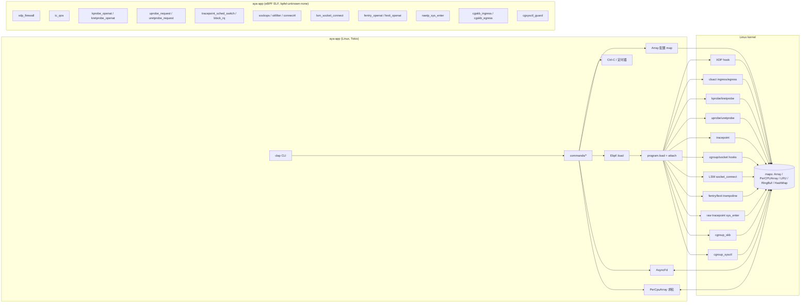

# aya-app 设计文档

本文说明 `aya-app` 的整体架构、数据流、构建链、资源生命周期、并发与性能取舍，以及扩展新场景的方法。场景级的使用步骤见 `docs/scenarios/`。

---

## 1. 目标与非目标

### 1.1 目标

1. 用同一套 Rust/Aya 工程覆盖十一类 eBPF 挂钩点，展示每类挂钩点的**能力边界**（观测 vs 拦截）。
2. 用户态与 eBPF 共享一份 `#[repr(C)]` ABI，事件、配置、统计不会结构体漂移。
3. 每个场景都有可操作的策略、可观测的统计和有界的内存使用，而不是只打印 “hello”。
4. 在非 Linux 开发机上也能对两个目标做类型检查，降低 IDE/CI 门槛。
5. 文档解释“为什么这样设计”，而不只是“怎么运行”。

### 1.2 非目标

- 不是生产级 DDoS 清洗器、QoS 调度器或安全 agent；没有控制面、持久化、热更新、指标导出。
- 不实现 IPv6 策略、NAT、连接跟踪、USDT、fentry/fexit。
- 不尝试在非 Linux 平台加载 eBPF；这些平台只支持类型检查。
- 不提供内核模块；全部通过 eBPF verifier 和 UAPI。

---

## 2. 总体架构



### 2.1 两个编译目标

| 目标 | crate | 说明 |
|---|---|---|
| `x86_64-unknown-linux-gnu`（或其他 Linux） | `aya-app` | 用户态 CLI；依赖 `aya`、Tokio、clap |
| `bpfel-unknown-none` | `aya-app-ebpf` | `no_std` eBPF；依赖 `aya-ebpf`、共享 ABI |

`aya-app-common` 同时被两边依赖：

- eBPF 侧不启用 `user` feature，保持 `no_std`，不引入 `aya` 用户态依赖；
- 用户态启用 `user` feature，为共享类型实现 `aya::Pod`，使 `Array`/`RingBuf` 可以直接解码。

### 2.2 为什么共享 ABI 单独成 crate

如果事件结构分别定义在两边，任何字段增删都可能只改一边。内核不会做类型检查，结果就是“用户态打印随机数”这类静默错误。共享 crate + `size_of` 编译期断言把问题提前到编译期：

```rust
const _: () = {
    assert!(size_of::<XdpEvent>() == 24);
    // ...
};
```

---

## 3. 构建链

```mermaid
sequenceDiagram
    participant Cargo
    participant Build as aya-app/build.rs
    participant AyaBuild as aya-build
    participant Nightly as cargo +nightly
    participant Linker as bpf-linker
    participant Out as OUT_DIR/aya-app-<scenario>

    Cargo->>Build: 编译 aya-app 前执行
    Build->>Build: 检查 bpf-linker / 处理 AYA_BUILD_SKIP
    Build->>AyaBuild: build_ebpf([aya-app-ebpf])（一次，--bins）
    AyaBuild->>Nightly: cargo build -p aya-app-ebpf --bins --release \
        --target bpfel-unknown-none -Z build-std=core
    Nightly->>Linker: 每个 bin 独立链接 .o，生成 BTF
    Linker->>Out: 11 个产物，build.rs 重命名为 aya-app-<scenario>
    Build-->>Cargo: rerun-if-changed 结束
    Cargo->>Cargo: include_bytes_aligned!(OUT_DIR/aya-app-<scenario>)
```

关键点：

- `rust-src` 提供 `core` 源码，`-Z build-std=core` 为 BPF 目标编译 `core`；
- `bpf-linker` 负责最终链接和 BTF 生成；
- `aya-build` 使用独立的 `target-dir`，避免与用户态 Cargo 锁冲突；
- `AYA_BUILD_SKIP=1` 或 `AYA_APP_SKIP_EBPF_BUILD=1` 时，`build.rs` 写入占位文件，只用于 `cargo check`；
- 占位对象不是合法 ELF，运行时会得到明确错误，不会静默加载。

`aya-app-ebpf` 的 `[[bin]]` 名称是 `aya-app`，因此 `aya-build` 把产物复制为 `OUT_DIR/aya-app`；
`build.rs` 随后按场景复制为 `OUT_DIR/aya-app-<scenario>`，`include_bytes_aligned!` 使用该路径。

每个场景对应一个 `[[bin]]`，只 include 本场景的 program/map 模块；这避免了“加载全部 map”的内存成本。

---

## 4. 程序与 map 清单

### 4.1 eBPF 程序

| 程序名 | 程序类型 | ELF section | 附加方式 | 作用 |
|---|---|---|---|---|
| `xdp_firewall` | XDP | `xdp` | `Xdp::attach(iface, mode)` | ICMP/限速 |
| `tc_qos` | SchedClassifier | `classifier` | `SchedClassifier::attach(iface, ingress/egress)` | 丢包 + mark |
| `kprobe_openat` | KProbe | `kprobe` | `KProbe::attach(symbol, 0)` | 记录开始、路径事件 |
| `kretprobe_openat` | KProbe (return) | `kretprobe` | 同一符号 | 延迟、返回值 |
| `uprobe_request` | UProbe | `uprobe` | `UProbe::attach([symbol], binary, scope)` | 参数事件 |
| `uretprobe_request` | UProbe (return) | `uretprobe` | 同一符号 | 延迟 |
| `tracepoint_sched_switch` | TracePoint | `tracepoint/sched/sched_switch` | `TracePoint::attach("sched","sched_switch")` | 调度事件 |
| `tracepoint_block_rq` | TracePoint | `tracepoint/block/block_rq_issue` | `TracePoint::attach("block","block_rq_issue")` | 块 I/O 事件 |
| `sockops_guard` | SockOps | `sockops` | `SockOps::attach(cgroup, mode)` | 连接遥测 |
| `skfilter_guard` | SocketFilter | `socket` | `SocketFilter::attach(socket)` | 入站 SYN 白名单 |
| `connect4_guard` | CgroupSockAddr | `cgroup/connect4` | `CgroupSockAddr::attach(cgroup, mode)` | 出站端口白名单 |
| `lsm_socket_connect` | LSM | `lsm.s/socket_connect` | `Lsm::load("socket_connect", &btf)` + `attach()` | 全局出站端口拦截 |
| `fentry_openat` | FEntry | `fentry/do_sys_openat2` | `FEntry::load(fn, &btf)` + `attach()` | 入口时间戳 |
| `fexit_openat` | FExit | `fexit/do_sys_openat2` | `FExit::load(fn, &btf)` + `attach()` | 延迟/返回值 |
| `rawtp_sys_enter` | RawTracePoint | `raw_tp/sys_enter` | `RawTracePoint::attach("sys_enter")` | syscall 过滤 |
| `cgskb_ingress` | CgroupSkb | `cgroup_skb/ingress` | `CgroupSkb::attach(cgroup, Ingress, mode)` | cgroup 入站丢包 |
| `cgskb_egress` | CgroupSkb | `cgroup_skb/egress` | `CgroupSkb::attach(cgroup, Egress, mode)` | cgroup 出站丢包 |
| `cgsysctl_guard` | CgroupSysctl | `cgroup/sysctl` | `CgroupSysctl::attach(cgroup, mode)` | 拒绝 sysctl 写入 |

### 4.2 map 清单

| map | 类型 | 大小/条目 | 键 → 值 | 使用场景 |
|---|---|---|---|---|
| `xdp_config` | Array | 1 | u32 → `XdpConfig` | XDP 配置 |
| `xdp_stats` | PerCpuArray | 1 | u32 → `XdpStats` | XDP 精确计数 |
| `xdp_rate` | LRU HashMap | 16384 | u32 源 IP → `RateState` | 单 IP 限速（可按需调大） |
| `xdp_events` | RingBuf | 256 KiB | — → `XdpEvent` | 采样丢弃事件 |
| `tc_config` | Array | 1 | u32 → `TcConfig` | TC 配置 |
| `tc_stats` | PerCpuArray | 1 | u32 → `TcStats` | TC 计数 |
| `tc_events` | RingBuf | 256 KiB | — → `TcEvent` | 采样丢包事件 |
| `kprobe_config` | Array | 1 | u32 → `KprobeConfig` | 前缀/阈值 |
| `kprobe_stats` | PerCpuArray | 1 | u32 → `KprobeStats` | 计数 |
| `kprobe_events` | RingBuf | 256 KiB | — → `KprobeEvent` | 路径/延迟事件 |
| `probe_start` | HashMap | 16384 | u64 pid_tgid → u64 ns | kprobe/uprobe/fentry 共享在途时间戳 |
| `uprobe_config` | Array | 1 | u32 → `UprobeConfig` | 延迟阈值 |
| `uprobe_stats` | PerCpuArray | 1 | u32 → `UprobeStats` | 计数 |
| `uprobe_events` | RingBuf | 256 KiB | — → `UprobeEvent` | 参数/延迟事件 |
| `tp_offsets` | Array | 1 | u32 → `TracepointOffsets` | 动态字段偏移 |
| `tp_control` | Array | 1 | u32 → `TracepointControl` | 采样率 |
| `tp_sched_stats` | PerCpuArray | 1 | u32 → `SchedStats` | 调度计数 |
| `tp_block_stats` | PerCpuArray | 1 | u32 → `BlockStats` | 块 I/O 计数 |
| `tp_sched_events` | RingBuf | 256 KiB | — → `SchedEvent` | 采样调度事件 |
| `tp_block_events` | RingBuf | 256 KiB | — → `BlockEvent` | 块 I/O 事件 |
| `sockops_config` | Array | 1 | u32 → `SockOpsConfig` | 端口过滤 |
| `sockops_stats` | PerCpuArray | 1 | u32 → `SockOpsStats` | 计数 |
| `sockops_events` | RingBuf | 256 KiB | — → `SockOpsEvent` | 连接生命周期 |
| `skfilter_config` | Array | 1 | u32 → `SkfilterConfig` | 是否启用白名单 |
| `skfilter_stats` | PerCpuArray | 1 | u32 → `SkfilterStats` | SYN/丢弃计数 |
| `skfilter_allowed` | HashMap | 1024 | u32 源 IP → u8 | 源 IP 白名单 |
| `connect4_config` | Array | 1 | u32 → `Connect4Config` | 允许端口 |
| `connect4_stats` | PerCpuArray | 1 | u32 → `Connect4Stats` | 计数 |
| `connect4_events` | RingBuf | 256 KiB | — → `Connect4Event` | 拒绝事件（1/16 采样） |
| `lsm_config` | Array | 1 | u32 → `LsmConfig` | 端口黑名单/UID/采样 |
| `lsm_stats` | PerCpuArray | 1 | u32 → `LsmStats` | 连接/拒绝计数 |
| `lsm_events` | RingBuf | 256 KiB | — → `LsmEvent` | 采样拒绝事件 |
| `fentry_config` | Array | 1 | u32 → `FentryConfig` | 延迟阈值/采样 |
| `fentry_stats` | PerCpuArray | 1 | u32 → `FentryStats` | 入口/出口/慢调用 |
| `fentry_events` | RingBuf | 256 KiB | — → `FentryEvent` | 延迟事件 |
| `rawtp_config` | Array | 1 | u32 → `RawTpConfig` | syscall 号/采样 |
| `rawtp_stats` | PerCpuArray | 1 | u32 → `RawTpStats` | 匹配/输出计数 |
| `rawtp_events` | RingBuf | 256 KiB | — → `RawTpEvent` | syscall 事件 |
| `cgskb_config` | Array | 1 | u32 → `CgSkbConfig` | 端口/采样 |
| `cgskb_stats` | PerCpuArray | 1 | u32 → `CgSkbStats` | pass/drop/bytes |
| `cgskb_events` | RingBuf | 256 KiB | — → `CgSkbEvent` | 丢弃事件 |
| `cgsysctl_config` | Array | 1 | u32 → `CgSysctlConfig` | 是否阻止写入/采样 |
| `cgsysctl_stats` | PerCpuArray | 1 | u32 → `CgSysctlStats` | calls/writes/blocked |
| `cgsysctl_events` | RingBuf | 256 KiB | — → `CgSysctlEvent` | 拒绝写入事件 |

> 每个场景对象在 `Ebpf::load` 时只创建该场景的 map。比如 `xdp` 对象没有 LSM、kprobe 或
> socket 的 ring buffer；map 表是全局清单，具体对象只包含其中对应的一行或几行。

### 4.3 配置写入顺序

```text
Ebpf::load
  → 创建 map
  → 用户态写 Array 配置 / HashMap 白名单
  → program.load（verifier）
  → program.attach
  → take_map（RingBuf / PerCpuArray）交给异步读取
```

配置必须在 attach 前写入；eBPF 侧把配置当作只读。HashMap 白名单也必须在 attach 前填充，否则第一个 SYN 可能看到空表。

---

## 5. 数据流

### 5.1 事件：RingBuf

```mermaid
flowchart LR
    P[eBPF 程序] -->|EVENTS.output(&event,0)| R[(RingBuf 256 KiB)]
    R -->|epoll readable| A[AsyncFd]
    A -->|next()| D[decode::<T>]
    D -->|read_unaligned| C[println / 聚合]
```

- 统一 256 KiB，2 的幂且页对齐；
- 每个事件是固定大小的 `#[repr(C)]` 结构；
- 用户态 `decode` 先检查长度，再 `read_unaligned`，不信任内核给的字节数；
- 高频率挂钩点（XDP drop、TC drop、sched_switch、connect4 deny）在 eBPF 侧采样，统计仍精确；
- ring buffer 满时事件丢失，程序不阻塞；这是可观测性损失，不是策略失败。

### 5.2 统计：PerCpuArray

```text
eBPF: STATS.get_ptr_mut(0) → 当前 CPU 的 slot → 直接 +=
用户态: PerCpuArray::get(&0, 0) → 每个可能 CPU 的值 → 求和
```

为什么不用 `Array<u64>` + 原子加：

- 原子操作在 XDP/TC 热路径上会争用同一个 cacheline；
- per-CPU 计数没有跨核同步，读取时短暂不一致可接受；
- 求和发生在用户态每秒一次，成本可忽略。

### 5.3 配置：Array 只读

- 单元素 `Array`，key=0；
- 在 attach 前写入，之后不再修改；
- 避免在热路径上加锁或读用户态内存；
- 需要热更新时应改用 `HashMap`/`Array` 的多元素配置并设计版本号，本项目不做。

---

## 6. 十一个场景的设计取舍

### 6.1 XDP

- **模式**：`Default` 让内核选择；`Skb` 兼容性最好；`Driver` 最快；`Hw` 需要网卡支持。
- **包解析**：以太网 + 最多两层 VLAN + IPv4；非首片段、非 IPv4、截断包一律放行，避免误伤。
- **ICMP**：只丢 `echo request`（type 8），不丢所有 ICMP，避免破坏 PMTUD/traceroute。
- **限速**：固定 1 秒窗口，每源 IP 一个 `RateState`；`LruHashMap` 限制内存，适合伪造源 IP 的攻击。
- **保护前缀**：`protected_ip` 为 0 表示所有目的地址；否则按掩码匹配。
- **统计与事件**：per-CPU 精确统计；事件按 `event_sample` 采样。
- **局限**：窗口边界最坏 2 倍速率；不做每 IP 并发连接数限制；不做 TCP 状态跟踪。

### 6.2 TC

- **方向**：ingress 可用于入向过滤；egress 用于 QoS。
- **丢弃**：按目的端口命中 `drop_ports`，返回 `TC_ACT_SHOT`。
- **优先级**：不直接写 `skb->priority`（aya 的 `TcContext` 未暴露该字段），而是写 `skb->mark`；用户态输出 `tc filter ... fw` 命令，把 mark 映射到 `prio` qdisc 的 band。
- **解析**：使用 `TcContext::load`（`bpf_skb_load_bytes`），兼容非线性 skb；代价是每包头几次 helper 调用。
- **局限**：mark 只在 egress + 已配置 qdisc 时有队列意义；ingress 的 mark 只对入向策略有用。

### 6.3 kprobe

- **符号**：默认 `do_sys_openat2`，它是现代 `openat(2)` 的公共实现（不同内核可能内联/改名，CLI 支持覆盖）。
- **参数**：`arg(1)` 被当作 `const char __user *filename`；这是默认符号的签名约定，不是通用 ABI。
- **路径读取**：`bpf_probe_read_user_str_bytes`，失败则不上报，避免把内核地址当用户字符串。
- **前缀匹配**：最多 4 个、每个 63 字节；固定上限让 verifier 能证明循环终止。
- **延迟**：`HashMap<pid_tgid, start_ns>`；返回时查找并删除。表满时对应返回事件缺失，但入口统计仍准确。
- **局限**：路径事件和延迟事件是分开的；返回时无法恢复路径；嵌套/并发 open 用 `pid_tgid` 区分。

### 6.4 uprobe

- **目标**：自带 `aya-app-demo`，导出 `#[unsafe(no_mangle)] extern "C"` 函数，保证符号名稳定。
- **参数**：`request_id` 是 arg0，`path` 是 arg1 用户指针；与 demo 的 ABI 一致。
- **返回**：uretprobe 通过 `pid_tgid` 配对，延迟阈值过滤。
- **scope**：默认 `AllProcesses`；`--pid` 使用 `OneProcess`，要求进程已存在。
- **局限**：真实 C++ 符号需要 `nm -C`/`readelf` 处理 mangling；PIE 和共享库需要正确路径与偏移；uprobe 不跟踪内联函数。

### 6.5 tracepoint

- **稳定性**：tracepoint 事件名/字段是内核 ABI 的一部分，但 `trace_event_raw_*` 的字节布局会随版本/配置变化。
- **动态偏移**：用户态解析 `format`，只把 offset/size 写入 map；eBPF 用 `read_at` + `bpf_probe_read_kernel`，失败就跳过事件。
- **字段校验**：必需字段大小不匹配直接拒绝启动；`bytes` 可选，缺失时记 0。
- **采样**：`sched_switch` 默认 1/64，`block_rq_issue` 默认全量；统计精确。
- **局限**：只解析两个事件；`prev_state` 32/64 位都支持；没有 BTF CO-RE 的字段级类型安全。

### 6.6 socket

三种挂钩点的能力边界：

| 挂钩点 | 触发 | 返回值 | 能否拦截 | 本项目用途 |
|---|---|---|---|---|
| `BPF_PROG_TYPE_SOCK_OPS` | TCP 生命周期回调 | `_CB` 忽略；查询类用 `reply` | ❌ | 遥测、状态回调 |
| `BPF_PROG_TYPE_SOCKET_FILTER` | socket 收到包 | 0 丢弃；len 通过；小于 len 截断 | ✅ 入站 | SYN 源 IP 白名单 |
| `BPF_CGROUP_INET4_CONNECT` | `connect(2)` | 1 允许、0 拒绝 | ✅ 出站 | 目的端口白名单 |

**socket filter 的偏移陷阱**：对 `AF_INET/TCP` socket，`skb->data` 指向 **TCP 头**，不是 IP 头。项目用 `bpf_skb_load_bytes_relative(..., BPF_HDR_START_NET)` 读取网络层，从而稳定拿到源 IP，再按 `ihl` 读取 TCP 头。只对 SYN（且非 ACK）做白名单，避免误伤已建立连接和 ICMP 错误。

**SOCK_OPS 的语义**：`BPF_SOCK_OPS_TCP_CONNECT_CB` 等回调只通知，返回 1 只是“成功”，不会拒绝连接；`reply` 字段用于查询类操作。因此 `sockops` 子命令明确只做遥测。

**connect4 的安全边界**：附加到根 cgroup 会影响整机；文档要求使用专用子 cgroup，并至少提供一个允许端口。BPF 内部配置为空时 fail-open（返回 allow），防止用户态错误导致断网；用户态 CLI 直接拒绝空列表。

### 6.7 LSM

- **钩子**：`socket_connect`，`LSM_HOOK(int, 0, socket_connect, struct socket *, struct sockaddr *, int)`。
- **sleepable**：`socket_connect` 在 `sleepable_lsm_hooks` 中，程序必须用 `#[lsm(sleepable, ...)]`（section `lsm.s/...`），aya 会设置 `BPF_F_SLEEPABLE`；否则 load 成功但 attach 返回 `EBUSY`。
- **BTF 参数**：`LsmContext::arg(1)` 是内核 `sockaddr *`，arg 2 是 `addrlen`，arg 3 是前一个 LSM 的返回值；先尊重前一个拒绝，再执行本策略。
- **解析**：`sockaddr_in` 是稳定 UAPI；读取 `sin_family`（主机序）、`sin_port`（网络序转主机序）、`sin_addr`（原始网络序）。
- **返回**：命中黑名单返回 `-EPERM`；其他情况返回 0。仅 IPv4，IPv6/AF_UNIX 放行。
- **作用域**：LSM 是全局钩子，不是 cgroup 作用域；配置提供可选 `uid` 过滤，CLI 要求显式 `--block-port`。
- **依赖**：`CONFIG_BPF_LSM=y`、BTF、`lsm=` 中包含 `bpf`；`Lsm::load` 需要以 hook 名查 BTF。
- **局限**：本案例是端口黑名单，不是完整防火墙；文件类 LSM 钩子需要额外解析 `struct file`/路径。

---

### 6.8 fentry / fexit

- **挂载**：`FEntry::load(fn, &btf)` / `FExit::load(fn, &btf)`，`attach()` 走 BPF trampoline；
- **入口状态**：`HashMap<pid_tgid, start_ns>` 记录在途调用，出口 `get_ptr` + `remove`；
- **返回值**：fexit 用 `bpf_get_func_ret`，因此需要 Linux 5.17+；
- **取舍**：嵌套调用会覆盖同一线程的起始时间；事件采样只影响 ring buffer。

### 6.9 raw tracepoint

- **挂载**：`RawTracePoint::load()` + `attach("sys_enter")`；
- **参数**：`sys_enter` 的 `arg(1)` 是 syscall 号，直接比较配置；
- **取舍**：不解析 tracefs format，但 syscall 号与架构相关；CLI 要求用户显式指定。

### 6.10 cgroup_skb

- **挂载**：`CgroupSkb::attach(cgroup, Ingress/Egress, mode)`；
- **数据起点**：`__sk_buff.data` 指向 IPv4 头，没有 Ethernet 头；
- **返回**：1 = drop，0 = allow；
- **取舍**：策略按 cgroup 而不是网卡；非 TCP/UDP 和非首片直接放行。

### 6.11 cgroup_sysctl

- **挂载**：`CgroupSysctl::attach(cgroup, mode)`；
- **上下文**：`bpf_sysctl` 只有 `write`/`file_pos`，没有 sysctl 名称；
- **返回**：1 = allow，0 = 内核转换为 `-EPERM`（与常见 0/1 语义相反）；
- **取舍**：只能做 cgroup 级“所有写”策略；更细粒度需要 LSM/路径解析。

---

## 7. 资源生命周期

```text
进程启动
  ├─ Ebpf::load：创建 map、解析程序
  ├─ 写配置
  ├─ program.load：verifier 通过，创建 prog fd
  ├─ program.attach：创建 link（fd/perf event/netlink），link 保存在 ProgramData
  ├─ take_map：RingBuf/PerCpuArray fd 移交用户态
  └─ 事件循环
        ├─ Ctrl-C
        └─ drop(bpf)
              ├─ link Drop → detach
              ├─ program fd close
              └─ map fd close（用户态已 take 的 map 由用户态变量 Drop）
```

特殊清理：

- **XDP/TC**：link drop 会 detach；TC 的 `clsact` qdisc 不会自动删除，需要 `tc qdisc del dev <iface> clsact`。
- **kprobe/uprobe**：perf event link 随 link fd 关闭而 detach。
- **tracepoint**：perf event link 同理。
- **socket filter**：没有 link 抽象；关闭监听 socket 或显式 `SO_DETACH_BPF` 才会移除。命令退出时关闭 listener。
- **cgroup**：link fd 关闭 detach；cgroup 本身保留。
- **LSM**：raw tracepoint link fd 关闭 detach；没有额外的 cgroup/qdisc 资源需要清理。
- **fentry/fexit**：trampoline link fd 关闭 detach；在途 HashMap 由程序卸载自动释放。
- **raw tracepoint**：raw TP link fd 关闭 detach。
- **cgroup_skb / cgroup_sysctl**：cgroup link fd 关闭 detach；不修改 qdisc。

---

## 8. 并发、性能与 verifier

### 8.1 并发

- eBPF 程序在 CPU 上不可抢占；per-CPU map 值天然无锁。
- XDP LRU 是唯一跨 CPU 共享的可变状态；读-改-写不是原子的，计数可能轻微丢失，文档明确说明“近似限速”。
- 用户态只有一个 Tokio 任务读取 ring buffer；没有多读者竞争。
- `PROBE_START` 是 kprobe/uprobe/fentry 共享的 HashMap（CLI 一次只运行一个场景）；`insert`/`remove` 由内核 map 实现保证安全，值语义是“最后一次写入”。

### 8.2 性能

| 场景 | 热路径成本 | 控制手段 |
|---|---|---|
| XDP | 包解析 + 一次 LRU 查找 | native 模式、采样事件、per-CPU 统计 |
| TC | 每头一次 `bpf_skb_load_bytes` | 只看 L2/L3/L4 头，不读 payload |
| kprobe | 每次 open 一次 map 更新 + 可选字符串读 | 仅在前缀匹配时构造事件 |
| uprobe | 每次调用一次 map 更新 + 一次事件 | 延迟阈值过滤退出事件 |
| tracepoint | 每次事件若干 `bpf_probe_read_kernel` | sched 默认 1/64 采样 |
| socket | 每个 SYN 几次相对读 | 只处理 SYN；非 SYN 直接放行 |
| LSM | 每个 `connect()` 一次 hook + 一次 `sockaddr_in` 读取 | 只解析 IPv4；可选 UID 过滤 |
| fentry/fexit | 每次调用一次 hash 更新/删除 + 一次 `bpf_get_func_ret` | 只在阈值/采样命中时输出 |
| raw tracepoint | 每个 syscall 一次比较 + 命中时一次 ringbuf 写入 | BPF 内先过滤 syscall 号 |
| cgroup_skb | 每个包一次 IPv4/L4 解析 | 只处理首片 TCP/UDP |
| cgroup_sysctl | 每次 sysctl 读写一次字段读取 | 只在写且策略启用时拒绝 |

### 8.3 verifier 约束

- 所有循环都有编译期上界（`MAX_PORTS=8`、`MAX_PREFIXES=4`、`PREFIX_LEN=64`）；
- 所有包访问都有 `data..data_end` 边界检查；
- 字符串读取使用 helper，绝不直接解引用用户/内核指针；
- 事件结构尽量控制在 200 字节以内，栈使用低于 512 字节；
- 动态 tracepoint 偏移只用于 helper 的 `unsafe_ptr`，不做直接解引用；
- `sock_addr` 字段使用常量偏移直接读取（上游 aya 集成测试也采用该模式）；
- LSM 使用 BTF 参数读取 `sockaddr *`，再用 `bpf_probe_read_kernel` 复制 `sockaddr_in`，不做直接解引用。

---

## 9. 错误处理

- 用户态统一 `anyhow::Result`，错误链包含“哪个 map/程序/符号/接口”；
- `program.load` 失败时提示 `RUST_LOG=debug` 查看 verifier log；
- 配置在 attach 前校验（端口数量、前缀长度、空白名单、PID=0）；
- eBPF 解析失败一律 fail-open（放行），避免畸形包造成黑洞；
- connect4 内部配置缺失 fail-open，CLI 拒绝空 allowlist；
- LSM 尊重前一个 LSM 的拒绝；内部错误返回 0，避免误拒；
- ring buffer 读取用 `?` 传播，Ctrl-C 用 `select!` 正常退出；
- 统计读取失败只影响打印，不影响数据面。

---

## 10. 安全设计

1. **最小权限**：只要求加载/附加所需能力；不修改内核参数。
2. **最小作用域**：XDP/TC 绑定接口；socket/cgroup 绑定路径；LSM 支持 `--uid`；文档反复强调不要对根 cgroup 直接做 `connect4`、不要在共享主机上随意做全局 LSM 拦截。
3. **不可信输入**：包内容、路径、用户指针都通过 helper 读取并做边界检查。
4. **隐私**：kprobe 默认只匹配 `/etc/shadow`、`/etc/passwd`；路径最多 128 字节；不采集文件内容。
5. **拒绝静默失败**：tracepoint 格式不匹配直接报错；配置非法直接报错；占位 eBPF 对象加载时报错。
6. **可回滚**：所有 link 随进程退出 detach；TC qdisc 的清理命令在文档中给出。

---

## 11. 测试策略

### 11.1 已覆盖

- `cargo fmt --check`；
- `cargo check`（Linux 用户态目标）；
- `cargo +nightly check`（`bpfel-unknown-none`，`-Z build-std=core`）；
- `cargo clippy`（用户态）；
- `aya-app-common` 的编译期布局断言；
- `tracefs::Format::parse` 的单元测试（在 Linux 上运行）；
- QEMU + Alpine `linux-lts` 上的 eBPF 最终链接、verifier、attach 和事件读取：
  XDP、TC、kprobe、uprobe、tracepoint、socket、LSM、fentry/fexit、raw tracepoint、
  cgroup_skb、cgroup_sysctl。

### 11.2 Linux 上的人工验证清单

1. `cargo build --release` 成功，`bpftool prog show` 能看到程序；
2. XDP：`ip link show`、`bpftool net show`、`ping` 行为符合预期；
3. TC：`tc -s qdisc`、`tc filter show`、`nc` 连接行为；
4. kprobe：`cat /etc/shadow` 触发；`/proc/kallsyms` 确认符号；
5. uprobe：`nm -D` 确认符号；demo 输出与事件时间对应；
6. tracepoint：`format` 文件存在；`dd`/`stress-ng` 触发；
7. socket：`curl` 允许/拒绝；`ss -tnp` 观察连接；`bpftool cgroup tree` 确认附加；
8. LSM：`cat /sys/kernel/security/lsm` 含 `bpf`；`nc` 连接被 `EPERM` 拒绝；`bpftool prog show`/`link show` 确认；
9. fentry/fexit：`cat /etc/hosts` 后看到 `[fexit]` 和 `enters/exits`；
10. raw tracepoint：`raw-tp --syscall-nr 257` 后看到 `[sys_enter] nr=257`；
11. cgroup_skb：cgroup 内客户端连接被 drop，统计增加；
12. cgroup_sysctl：cgroup 内 `sysctl -w` 返回 `EPERM`；
9. 退出后确认 `bpftool prog show` 中 link 消失（XDP/TC/kprobe 等）。

### 11.3 负向测试

- 不存在的接口、符号、tracepoint、cgroup；
- 端口/前缀超过上限；
- 非 root 运行；
- 无 tracefs、无 BTF；
- `--mode driver` 在不支持 XDP 的接口上；
- 空 `--allow-port`（应拒绝）；
- 空 `--block-port`（应拒绝）；
- 无 BPF LSM / `lsm=` 不含 `bpf`（应加载失败或不触发）；
- `AYA_BUILD_SKIP=1` 构建的二进制（应加载失败）。

---

## 12. 扩展新场景

以增加“cgroup/connect6”为例：

1. 在 `aya-app-common/src/lib.rs` 增加 `#[repr(C)]` 配置/事件/统计和 `size_of` 断言，并在 `pod` 模块登记；
2. 在 `aya-app-ebpf/src/programs/` 新建模块，定义 `#[map]`、`#[cgroup_sock_addr(connect6)]` 程序和事件；
3. 在 `aya-app-ebpf/src/bin/` 新建入口（include 对应模块与 panic handler），并在 `Cargo.toml` 增加 `[[bin]]`；
4. 在 `aya-app/src/cli.rs` 增加子命令与参数；
5. 在 `aya-app/src/commands/` 实现配置、attach、事件循环、统计；
6. 在 `main.rs` 分发；
7. 更新 `README.md`、`docs/design.md` 和场景文档；
8. 运行 `scripts/check.sh`，在 Linux 上做加载/行为验证。

约束：

- 程序名必须唯一，且与 `bpf.program_mut("...")` 一致；
- map 名必须唯一；
- 事件结构无隐式 padding，大小是 8 的倍数（ring buffer 对齐）；
- 新增循环必须有固定上界；
- 不能把“不可拦截”的挂钩点写成“拦截”。

---

## 13. 已知限制与后续方向

- IPv6 策略（当前 L3 仅 IPv4；LSM 也只解析 `sockaddr_in`）；
- TC egress 的 `skb->priority` 直接写（需要 aya 暴露字段或改用 `bpf_skb_store_bytes` 的替代方案）；
- kprobe 符号自适配（`do_sys_openat2` 可能被内联）；
- tracepoint BTF/CO-RE 字段访问（当前是运行时 offset）；
- LSM 文件类钩子（`file_open`/`bprm_check_security`）需要额外的 BTF 路径解析；
- fentry/fexit 的嵌套调用会覆盖同一线程的起始时间；
- cgroup_sysctl 只能按 cgroup 拒绝所有写，不能按 sysctl 名称过滤；
- Aya 0.16 未封装 netfilter、struct_ops/tcx/sched_ext、BPF_MODIFY_RETURN 等类型，详见 [aya-gaps.md](aya-gaps.md)；
- 用户态指标导出（Prometheus/OTLP）；
- 配置热更新与 pinning；
- 多读者 ring buffer / perf event array 对比；
- 自动化 Linux CI（QEMU + 自建内核或 GitHub Actions Ubuntu runner）。
